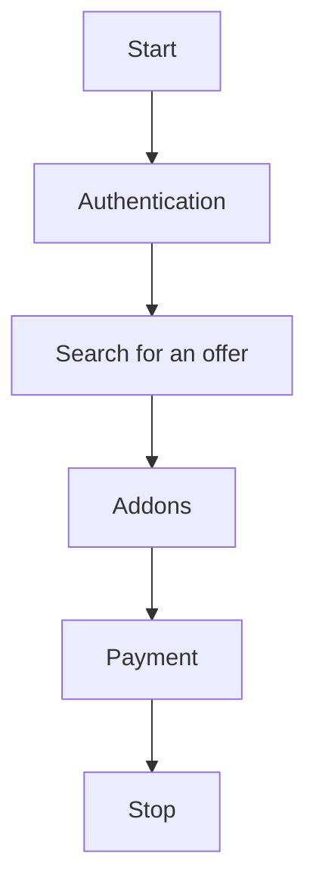

Um eine vollständige Integration zu erreichen, die besten Angebote und Zusatzservices zu suchen und Bestellungen aufzugeben, befolgen Sie bitte die folgenden Schritte:




## 1. Authentifizierung:
- Ein Konto im System globkurier.pl ist erforderlich. Sie können ein Konto über das Portal https://globkurier.pl erstellen.
- Die Authentifizierung des Endpunkts ermöglicht es, ein Token abzurufen, das alle Endpunktaufrufe im System autorisiert.
- Verwenden Sie den Endpunkt: [Generate token](../api/globkurier.md#/Authentication/authLoginR01)

## 2. Angebotssuche:
- Mit einem Token können Sie eine Produktsuche mit den dem angemeldeten Benutzer zugewiesenen Preisen ausführen.
- Verwenden Sie den Endpunkt: [Get products](../api/globkurier.md#/Products/productSearch)

    Wesentliche Informationen müssen angegeben werden:

    - Angaben zu Abmessungen (cm), Gewicht (kg) und Anzahl der Pakete: `width`,`height`,`length`,`weight`,`quantity`
    - ID des Landes, aus dem und in das wir versenden (die Liste abrufen über: [Get list of countries](../api/globkurier.md#/Countries/countryListR01): `senderCountryId`,`receiverCountryId`
    - Optional können Sie die Postleitzahlen der Standorte für eine genauere Suche angeben: `senderPostCode`,`receiverPostCode`
    - Optional können Sie außerdem die Sendungsart `packageType` und die Transportart `transportType` angeben (Konstanten aus der Einführung)
    - **Wesentliche** Information - **Versandart** (Kurierabholung, Paketautomat / Filiale / Punkt, Crossborder): `collectionTypes` - mehrere Werte (collectionTypes[]=1&collectionTypes[]=2)
    - **Wesentliche** Information - **Zustellart** (Kurierabholung, Paketautomat / Filiale / Punkt, Crossborder): `deliveryTypes` - mehrere Werte (deliveryTypes[]=1&deliveryTypes[]=2)

## 3. Produktauswahl
Aus der Antwort entnehmen wir die ID des Produkts, das wir bestellen möchten. Die Antwort enthält wesentliche Informationen für die Produktauswahl:

- Produktname für den Kunden: `name`
- Integrationsname und Servicecode (optionale Angaben): `carrierName`, `serviceCode`
- Netto-Versandbetrag: `netPrice`
- Bruttobetrag mit Treibstoffzuschlag: `grossPrice`
- Währung: `currency`
- ob das Produkt nur für Unternehmen gilt: `forCompany`
- mögliche Zusatzservice-Kategorien für das Produkt: `addonsCategories` (z. B. COD - "CASH_ON_DELIVERY", Versicherung - "INSURANCE"...)

## 4. Abruf der Zusatzservices für das ausgewählte Produkt
Nach der Auswahl des Produkts müssen Sie das gesamte Verzeichnis der für das Produkt verfügbaren Zusatzservices abrufen (Endpunkt: [Get addons for product](../api/globkurier.md#/Products/productGetAddons)) und dabei folgende Parameter übergeben:

- Produkt-ID: `productId`
- dieselben Abmessungen, Maße und dieselbe Anzahl der Pakete wie bei der Produktsuche (das System berechnet die entsprechenden Zuschlagsbeträge)
- dieselben Länder-IDs und Postleitzahlen (das System passt die entsprechenden Zuschlagsbeträge an und berechnet sie)
- optional können Sie COD- und Versicherungsparameter hinzufügen, um den passenden Zuschlag und Betrag passend zum COD- und Versicherungswert auszuwählen

## 5. Auswahl der Zusatzservices aus den Antworten
Als Antwort erhalten wir eine Liste aller Zusatzservices, die die Parameter erfüllen.
Wählen Sie aus der Antwortliste die Zusatzservices aus, die Sie bestellen möchten.
Die Antwort enthält wesentliche Informationen:

- ID des Zusatzservices: `id`
- Name: `addonName`
- Beschreibung: `description`
- Nettopreis: `price`
- Bruttopreis: `priceGross`
- Währung: `currency`
- Kategorie: `category`
- ob ein Zusatzservice für die Bestellung erforderlich ist: `isRequired`
- ob eine Versicherung erforderlich ist: `insuranceRequired`
- bei COD - Anzahl der Tage für die Rückzahlung: `daysToReturn`

## 7. Zahlung
Wir empfehlen die Verwendung von Prepaid-Zahlungen (frühere Einzahlungen auf Ihr Globkurier-Konto) - id = 3.
Andernfalls müssen Sie Zahlungsmethoden (z. B. online) integrieren:

- Abruf der Liste der Zahlungsmethoden: [Get list of payment methods](../api/globkurier.md#/Payment/paymentGetUserMethods)
- für Online-Zahlungen können Sie die URL für das Zahlungsformular abrufen: [Generate form data for online order payment](../api/globkurier.md#/Online%20Payments/paymentGenerateOrderForm). Die erforderlichen Daten sind:
    - `orderHash` - Hash nach Aufgabe einer Bestellung
    - `returnLink` - allgemeine Adresse, an die der Benutzer vom Zahlungsgateway zurückgeleitet werden soll, z. B. "https://test-url.com"
    - `returnSuccessLink` - optional die Adresse, an die der Benutzer nach erfolgreicher Zahlung vom Zahlungsgateway zurückgeleitet werden soll, z. B. "https://test-url.com/success"
    - `returnFailureLink`  - optional die Adresse, an die der Benutzer nach einer fehlerhaften Zahlung vom Zahlungsgateway zurückgeleitet werden soll, z. B. "https://test-url.com/failure"

- eine andere Zahlung als Prepaid muss nach Aufgabe der Bestellung erfolgen

## 8. Teil- und vollständige Datenvalidierung
In jeder Phase der Datenerfassung für die Bestellung können Sie die Richtigkeit der Daten überprüfen (z. B. nach Erfassung der Adressdaten). 
Das spart dem Kunden Zeit beim Versuch, eine Bestellung aufzugeben und Daten zu korrigieren.
Endpunkt: [Partial order validation](../api/globkurier.md#/Order%20Management/orderValidate)

## 9. Zusammenfassung der Beträge
Sie können eine Zusammenfassung der Beträge für alle erfassten Daten abrufen ([Pricing Summary before ordering (DE)](pricing-summary-before-ordering.md))

## 10. Aufgabe einer Bestellung
Sobald alle Daten validiert wurden und der Benutzer alle Zusammenfassungen bestätigt hat, kann im System eine Bestellung erstellt werden.
Endpunkt [Create order](../api/globkurier.md#/Orders/orderCreate):
Wesentliche Elemente, die im body gesendet werden:

- im Abschnitt `shipment`: Abmessungen, Gesamtabmessungen, Anzahl der Pakete wie bei der Produktsuche, `productId` - die genaue vom Benutzer gewählte ID.
- im Abschnitt `senderAddress`: 
    - `countryId` - Länder-ID wie bei der Produktsuche
    - `pointId` - Code des Punkts / PUDO / Terminals, von dem die Sendung versendet wird (falls für das gewählte Produkt zutreffend) - optional.
- im Abschnitt `receiverAddress`:
    - `countryId` - Länder-ID wie bei der Produktsuche
    - `pointId` - Code des Punkts / PUDO / Terminals, an dem die Sendung abgeholt wird (falls für das gewählte Produkt zutreffend) - obligatorisch.
- im allgemeinen Abschnitt:
    - `content` - Inhalt der Sendung
    - `paymentId` - Zahlungsmethode (bei Prepaid: id=3 oder id=9) die Sendung wird sofort bezahlt und ein Frachtbrief erzeugt, bei id=2 - online - die Zahlungsintegration muss abgeschlossen sein - Punkt 7)
    - `agreements` - für die Bearbeitung der Bestellung sind Einwilligungen erforderlich. Die aktuell erforderlichen Einwilligungen können über den Endpunkt abgerufen werden: [Get agreements](../api/globkurier.md#/Agreements/agreementListR01) für den Parameter filters[module] = order z. B.

        ```json
        "receiveElectronicBills": true,
        "processingPersonalData": true
        },
        ```

    - im Abschnitt addons genau dieselben Zusatzservices wie in der Preisermittlung. Die IDs der Zusatzservices sind entscheidend. 

        ```json
        {
            "id": 1578,
            "value": 1000
        },
        ```

        ```json
        {
            "id": 632,
            "value": 500,
            "bankAccountNumber": "PL00000000000000000000000",
            "name": "Name",
            "addressLine1": "Address line 1",
            "swiftCode": "CCFRFRPP"
        }
        ```

    - `purpose` - Zweck der Sendung (z. B. GIFT, SOLD, ...)
    - `collectionType`, `deliveryType` - Art des Versands und des Empfangs
    - `referenceNumber` - Bestellnummer im System des Kunden

## 11. Antwort nach Aufgabe einer Bestellung
Nach der Erzeugung der Bestellung enthält die Antwort Informationen zur Bestellnummer und zum Bestell-Hash. Diese Nummern werden für die weitere Bearbeitung verwendet.

## 12. Etikett abrufen [Labels (DE)](labels.md)

## 13. Tracking-Status [Tracking (DE)](tracking.md)
