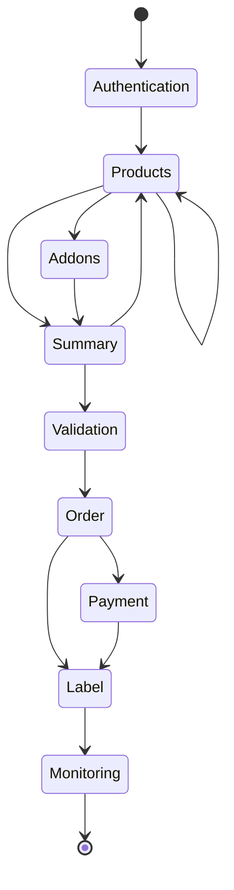
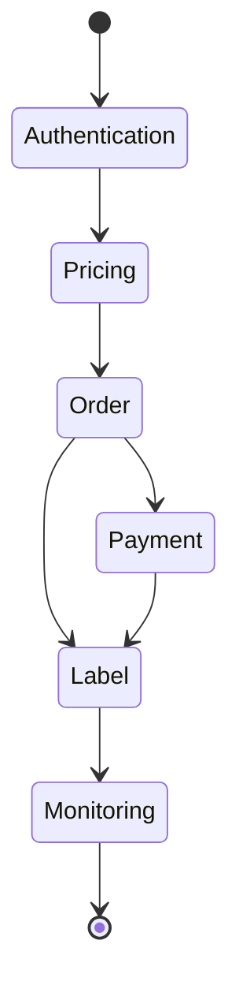

Bei der Integration von Bestellerstellung und Etikettenerzeugung stehen zwei Szenarien zur Verfügung:

## 1. Vollständiger Pfad

Dieser Pfad umfasst die Suche nach allen Produkten, die Ihren Kriterien entsprechen, die Auswahl des am besten geeigneten und die Auswahl des Zubehörs. Im nächsten Schritt werden Ihre Daten validiert und die Bestellung für das ausgewählte Produkt und das Zubehör aufgegeben.. 

Während der Bestellung können Sie Produkte wiederholt mit unterschiedlichen Parametern abfragen. Stimmt der Kunde dem Angebot nicht zu, kann er jederzeit zur Suche nach Produkten und Zubehör zurückkehren.

Zahlungen sollten mit den Zahlungsmethoden erfolgen, die dem angemeldeten Benutzer zur Verfügung stehen (oder, am einfachsten, per Prepaid).

In den nächsten Schritten laden wir ein Etikett für die aufgegebene und bezahlte Bestellung herunter. Das System ermöglicht es, den aktuellen Versandstatus abzufragen.

  

    

## 2. Schneller Pfad

Dieser Pfad besteht darin, die Versandkriterien und die zu verwendenden Zusatzservice-Kategorien anzugeben. Das System findet das beste Angebot für die angegebenen Kriterien und gibt die Bestellung für dieses Angebot auf.

Zahlungen sollten mit den Zahlungsmethoden erfolgen, die dem angemeldeten Benutzer zur Verfügung stehen (oder, am einfachsten, per Prepaid).

In den nächsten Schritten laden wir ein Etikett für die aufgegebene und bezahlte Bestellung herunter. Das System ermöglicht es, den aktuellen Versandstatus abzufragen.

