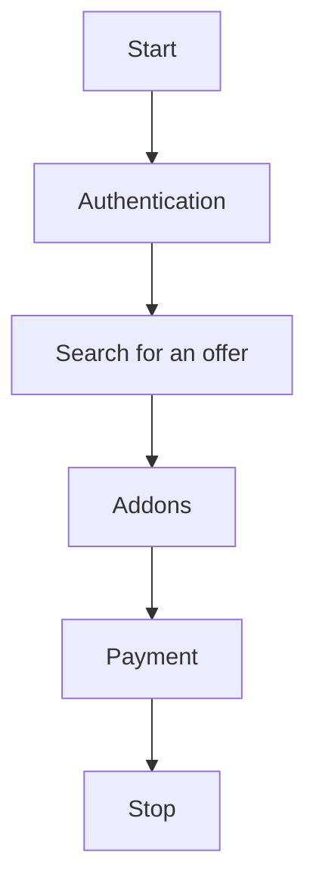

In order to achieve full integration, search for the best offers, add-ons, and place orders, please follow the steps below:




## 1. Authentication:
- An account in the globkurier.pl system is required. You can create an account through the portal https://globkurier.pl
- Endpoint authentication allows you to retrieve a token that authorizes all endpoint calls in the system.
- Use endpoint: [Generate token](../api/globkurier.md#/Authentication/authLoginR01)

## 2. Search for offers:
- With a token, you can run a product search with prices assigned to the logged-in user.
- Use endpoint: [Get products](../api/globkurier.md#/Products/productSearch)

    Key information must be provided:

    - Data on dimensions (cm), weight (kg) and number of packages: `width`,`height`,`length`,`weight`,`quantity`
    - ID of the country from which and to which we ship (download the list via: [Get list of countries](../api/globkurier.md#/Countries/countryListR01): `senderCountryId`,`receiverCountryId`
    - Optionally, you can enter location postcodes for greater search accuracy: `senderPostCode`,`receiverPostCode`
    - Optionally, you can also specify the shipment type `packageType`, transport type `transportType` (constants from Introduction)
    - **Key** information - **shipping method** (courier pickup, parcel locker / branch / point, crossborder): `collectionTypes` - multiple values (collectionTypes[]=1&collectionTypes[]=2)
    - **Key** information - **delivery method** (courier pickup, parcel locker / branch / point, crossborder): `deliveryTypes` - multiple values (deliveryTypes[]=1&deliveryTypes[]=2)

## 3. Product selection
From the response, we retrieve the ID of the product we want to order. The response contains key information for product selection:

- product name for the customer: `name`
- integration name and service code (optional data): `carrierName`, `serviceCode`
- net shipping amount: `netPrice`
- gross amount with fuel surcharge: `grossPrice`
- currency: `currency`
- is the product for companies only: `forCompany`
- possible add-on categories for the product: `addonsCategories` (e.g., COD - "CASH_ON_DELIVERY", Insurance - "INSURANCE"...)

## 4. Downloading add-ons for the selected product
After selecting the product, you need to download the entire dictionary of add-ons available for the product (endpoint: [Get addons for product](../api/globkurier.md#/Products/productGetAddons)) passing parameters:

- product ID: `productId`
- the same dimensions (length, width, height), weight and number of packages (quantity) as for the product search (the system will calculate the appropriate surcharge amounts)
- the same country IDs and postal codes (the system will adjust and calculate the appropriate surcharge amounts)
- optionally, you can add COD and insurance parameters to select the appropriate surcharge and amount to match the COD and insurance values

## 5. Selection of additions from the answers
In response, we'll receive a list of all add-ons that meet the parameters.
From the list of responses, select the add-ons you'd like to order.
The response contains key information:

- add-on ID: `id`
- name: `addonName`
- description: `description`
- net price: `price`
- gross price: `priceGross`
- currency: `currency`
- category: `category`
- whether an add-on is required for the order: `isRequired`
- whether insurance is required: `insuranceRequired`
- for COD - number of days for return: `daysToReturn`

## 6. Payment
We suggest using prepaid payments (earlier payments on your Globkurier account) - id = 3.
Otherwise, you must integrate payment methods (e.g. online):

- downloading a list of payment methods: [Get list of payment methods](../api/globkurier.md#/Payment/paymentGetUserMethods)
- for online payments you can download the url for the payment form: [Generate form data for online order payment](../api/globkurier.md#/Online%20Payments/paymentGenerateOrderForm). The required data is:
    - `orderHash` - hash after placing an order
    - `returnLink` - general address to which the user should be redirected from the payment gateway, e.g. "https://test-url.com"
    - `returnSuccessLink` - optionally, the address to which the user should be redirected from the payment gateway after successful payment, e.g. "https://test-url.com/success"
    - `returnFailureLink`  - optionally, the address to which the user should be redirected after an incorrect payment from the payment gateway, e.g. "https://test-url.com/failure"

- payment other than prepaid must be made after the order is placed

## 7. Partial and full data validation
At each stage of collecting data for placing an order, you can verify the accuracy of the data (e.g. after collecting address data). 
This saves the customer time when trying to place an order and correcting data.
Endpoint: [Partial order validation](../api/globkurier.md#/Order%20Management/orderValidate)

## 8. Summarized amounts
You can download a summary of the amounts for all collected data ([Pricing Summary before ordering (EN)](pricing-summary-before-ordering.md))

## 9. Placing an order
Once all data has been validated and the user has confirmed all the summaries, an order can be created in the system.
Endpoint [Create order](../api/globkurier.md#/Orders/orderCreate):
Key elements sent in the body:

- in the `shipment` section: dimensions, overall dimensions, number of packages as when searching for products, `productId` - the exact ID selected by the user.
- in the `senderAddress` section: 
    - `countryId` - country id as in product search
    - `pointId` - code of the point / PUDO / terminal where the shipment will be sent (if applicable for the selected product) - optional.
- in the `receiverAddress` section:
    - `countryId` - country id as in product search
    - `pointId` - code of the point / PUDO / terminal where the shipment will be collected (if applicable for the selected product) - mandatory.
- in the general section:
    - `content` - contents of the shipment
    - `paymentId` - payment method (for prepaid: id=3 or id=9) the shipment will be paid immediately and a waybill will be generated, for id=2 - online - payment integration must be completed - point 6)
    - `agreements` - consents are required to process the order. Currently required consents can be retrieved via the endpoint.: [Get agreements](../api/globkurier.md#/Agreements/agreementListR01) for the filters parameter[module] = order e.g.

        ```json
        "agreements": {
            "receiveElectronicBills": true,
            "processingPersonalData": true
        }
        ```

    - in the addons section exactly the same additional services as in the quote. The IDs of additional services are crucial. 

        ```json
        {
            "id": 1578,
            "value": 1000
        },
        ```

        ```json
        {
            "id": 632,
            "value": 500,
            "bankAccountNumber": "PL00000000000000000000000",
            "name": "Name",
            "addressLine1": "Address line 1",
            "swiftCode": "CCFRFRPP"
        }
        ```

    - `purpose` - purpose of shipment (e.g. GIFT, SOLD, ...)
    - `collectionType`, `deliveryType` - type of sending and receiving
    - `referenceNumber` - customer system order number

## 10. Response after placing an order
After generating the order, the response will contain information about the order number and the order hash. These numbers are used for further processing.

## 11. Get the label [Labels (EN)](labels.md)

## 12. Tracking statuses [Tracking (EN)](tracking.md)
