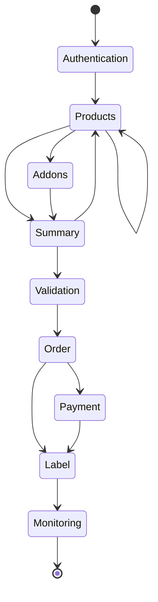
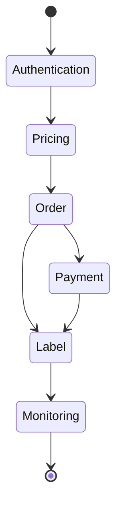

Within the integration of order creation and label generation, we have two possible scenarios:

## 1. Full path

This path involves searching for all products that meet your criteria, selecting the most suitable one, and selecting the accessories. The next step is to validate your data and place an order for the selected product and accessories.. 

When ordering, you can repeatedly query products with different parameters. If the customer disagrees with the quote, they can always return to search for products and accessories again.

Payments should be made using the payment methods available to the logged-in user (or, most simply, prepaid).

In the next steps, we download a label for the placed and paid order. The system allows us to query the current shipping status.

  

    

## 2. Fast path

The path involves entering the shipping criteria and the categories of add-ons to be used. The system will find the best offer for the specified criteria and place the order for that offer.

Payments should be made using the payment methods available to the logged-in user (or, most simply, prepaid).

In the next steps, we download a label for the placed and paid order. The system allows us to query the current shipping status.

