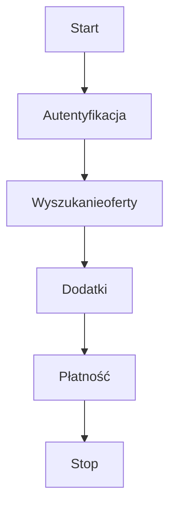

W celu dokonania pełnej integracji, wyszukiwania najlepszych ofert, dodatków, składania zamówień należy zastosować poniższe kroki:




## 1. Autentyfikacja:
- Wymagane jest posiadanie konta w systemie globkurier.pl. Konto można założyć poprzez portal https://globkurier.pl
- Endpoint do autentyfikacji pozwala na pobranie tokenu, który autoryzuje wszystkie wywołania endpointów w systemie.
- Użyj endpoint: [Generate token](../api/globkurier.md#/Authentication/authLoginR01)

## 2. Wyszukanie ofert:
- Posiadając token można uruchomić wyszukiwanie produktów wraz z cenami przypisanymi do zalogowanego użytkownika.
- Użyj endpoint: [Get products](../api/globkurier.md#/Products/productSearch)

    Należy  podać kluczowe informacje:

    - Dane o wymiarach (cm) , wadze (kg) i ilości paczek: `width`,`height`,`length`,`weight`,`quantity`
    - Id kraju, z którego i do którego wysyłamy (listę pobierz poprzez: [Get list of countries](../api/globkurier.md#/Countries/countryListR01): `senderCountryId`,`receiverCountryId`
    - Opcjonalnie dla większej dokładności wyszukania można podać kody pocztowe lokalizacji: `senderPostCode`,`receiverPostCode`
    - Opcjonalnie można podać również typ przesyłki `packageType`, typ transportu `transportType` (stałe z Introduction)
    - **Kluczowa** informacja - **sposób nadania** (podjazd kuriera, paczkomat / oddział / punkt, crossborder): `collectionTypes` - wiele wartości (collectionTypes[]=1&collectionTypes[]=2)
    - **Kluczowa** informacja - **sposób dostawy** (podjazd kuriera, paczkomat / oddział / punkt, crossborder): `deliveryTypes` - wiele wartości (deliveryTypes[]=1&deliveryTypes[]=2)

## 3. Wybór produktu 
Z odpowiedzi pobieramy ID produktu, który chcemy zamówić. Odpowiedź zawiera kluczowe informacje dla wyboru produktu:

- nazwa produktu dla klienta: `name`
- nazwa integracji i kod serwisowy (opcjonalne dane): `carrierName`, `serviceCode`
- kwota netto transportu: `netPrice`
- kwota brutto z opłatą paliwową: `grossPrice`
- waluta: `currency`
- czy produkt tylko da firm: `forCompany`
- możliwe kategorie dodatków dla danego produktu: `addonsCategories` (np. COD - "CASH_ON_DELIVERY", Ubezpieczenie - "INSURANCE"...)

## 4. Pobranie dodatków dla wybranego produktu
Po wybraniu produktu należy pobrać cały słownik dodatków dostępnych dla produktu (endpoint: [Get addons for product](../api/globkurier.md#/Products/productGetAddons)) przekazując parametry:

- id produktu: `productId`
- te same wymiary (długość, szerokość, wysokość), waga i liczba paczek (quantity) jak dla wyszukania produktu (system przeliczy odpowiednie kwoty dodatków)
- te same id kraju z którego i do którego wysyłamy oraz kody pocztowe (system dopasuje i przeliczy odpowiednie kwoty dodatków)
- opcjonalnie można dodać paramety COD i ubezpieczenia w celu dobrania odpowiedniego dodatku i kwoty do poziomu wartości COD i ubezpieczenia

## 5. Wybór dodatków z odpowiedzi
W odpowiedzi uzyskamy listę wszystkich dodatków spełniających parametry. Z listy odpowiedzi należy wybrać dodatki, które będą zamawiane.
Odpowiedź zawiera kluczowe informacje:

- id dodatku:`id`
- nazwa: `addonName`
- opis: `description`
- cena netto: `price`
- cena brutto: `priceGross`
- waluta: `currency`
- kategoria: `category`
- czy wymagany dodatek do zamówienia: `isRequired`
- czy ubezpieczenie jest wymagane: `insuranceRequired`
- dla COD - ilość dni na zwrot: `daysToReturn`

## 6. Płatność
Sugerujemy wykorzystanie płatności prepaid (wcześniejsze wpłaty na koncie Globkurier) - id = 3
W innym wypadku należy wykonać integrację metod płatności (np. online):

- pobranie listy metod płatności: [Get list of payment methods](../api/globkurier.md#/Payment/paymentGetUserMethods)
- dla płatności online można pobrać adres url dla formatki płatności: [Generate form data for online order payment](../api/globkurier.md#/Online%20Payments/paymentGenerateOrderForm). Wymagane dane, to:
    - `orderHash` - hash po złożonym zamówieniu
    - `returnLink` - ogólny adres, na który ma zostać przekierowany użytkownik z bramki płatności np. "https://test-url.com"
    - `returnSuccessLink` - opcjonalnie adres po poprawnej płatności, na który ma zostać przekierowany użytkownik z bramki płatności np. "https://test-url.com/success"
    - `returnFailureLink`  - opcjonalnie adres po błędnej płatności, na który ma zostać przekierowany użytkownik z bramki płatności np. "https://test-url.com/failure"

- płatność inna niż prepaid musi zostać wywołana po złożeniu zamówienia

## 7. Częściowa i pełna walidacja danych
Na każdym etapie zbierania danych do złożenia zamówienia można weryfikować poprawność danych (np. po pobraniu danych adresowych). 
Oszczędza to czas klientowi przy próbie składania zamówienia z poprawianiem danych.
Endpoint: [Partial order validation](../api/globkurier.md#/Order%20Management/orderValidate)

## 8. Podsumowanie kwot
Dla wszystkich zebranych danych można pobrać podsumowanie kwot ([Pricing Summary before ordering (PL)](pricing-summary-before-ordering.md))

## 9. Złożenie zamówienia
Po przejściu walidacji wszystkich danych, po potwierdzeniu przez użytkownika wszystkich podsumowań można stworzyć zamówienie w systemie. 
Endpoint [Create order](../api/globkurier.md#/Orders/orderCreate):
Kluczowe elementy wysyłane w body:

- w sekcji `shipment`: wymiary, gabaryty, ilość paczek jak przy wyszukiwaniu produktów, `productId` - dokładny ID wybrany przez użytkownika.
- w sekcji `senderAddress`: 
    - `countryId` - id kraju jak przy wyszukiwaniu produktów
    - `pointId` - kod punktu / PUDO / terminala , w którym nastąpi nadanie przesyłki (jeżeli wybrany produkt, tego dotyczy) - opcjonalnie.
- W sekcji `receiverAddress`:
    - `countryId` - id kraju jak przy wyszukiwaniu produktów
    - `pointId` - kod punktu / PUDO / terminala , w którym nastąpi odebranie przesyłki (jeżeli wybrany produkt, tego dotyczy) - obowiązkowo.
- W sekcji ogólnej:
    - `content` - zawartość przesyłki
    - `paymentId` - metoda płatności (dla prepaid: id=3 lub id=9) przesyłka zostanie opłacona od razu i wygenerowany zostanie list przewozowy, dla id=2 - online - należy dokonać integracji płatności - pkt 6)
    - `agreements` - wymagane jest przesłanie zgód na realizację zamówienia. Aktualnie wymagane zgody można pobrać za pomocą endpoint: [Get agreements](../api/globkurier.md#/Agreements/agreementListR01) dla parametru filters[module] = order np.

        ```json
        "agreements": {
            "receiveElectronicBills": true,
            "processingPersonalData": true
        }
        ```

    - w sekcji addons dokładnie te same usługi dodatkowe jak przy wycenie. Kluczowe są id usług dodatkowych. 

        ```json
        {
            "id": 1578,
            "value": 1000
        },
        ```

        ```json
        {
            "id": 632,
            "value": 500,
            "bankAccountNumber": "PL00000000000000000000000",
            "name": "Name",
            "addressLine1": "Address line 1",
            "swiftCode": "CCFRFRPP"
        }
        ```

    - `purpose` - cel przesyłki (ex. GIFT, SOLD, ...)
    - `collectionType`, `deliveryType` - typ nadania i odbioru
    - `referenceNumber` - numer zamówienia systemu klienta

## 10. Odpowiedź po złożeniu zamówienia
Po wygenerowaniu zamówienia w odpowiedzi znajdzie sie informacja o orderNumber i hash zamówienia. Numery wykorzystywane dalszego procesowania. 

## 11. Pobranie etykiety [Labels (PL)](labels.md)

## 12. Statusy przesyłki [Tracking (PL)](tracking.md)
