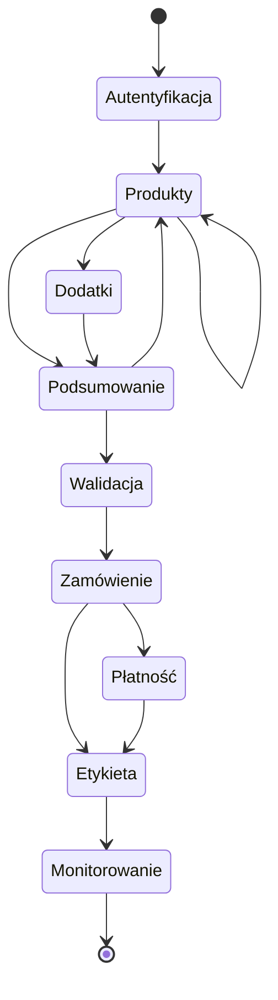
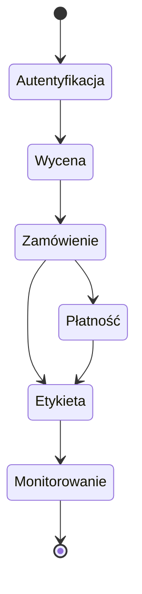

W ramach integracji tworzenia zamówienia i generowania etykiety mamy dwa możliwe scenariusze:

## 1. Ścieżka pełna

Ścieżka polega na wyszukaniu wszystkich produktów spełniających kryteria, wybranie jednego z najbardziej odpowiadających i dobranie do niego dodatków. W kolejnym kroku należy zwalidować dane i złożyć zamówienie na wybrany produkt i dodatki. 

W trakcie zamawiania można wielokrotnie odpytywać o Produkty z różnymi parametrami. Jeżeli klient nie zgadza się w wyceną, to zawsze można wrócić do wyszukania ponownie produktów i dodatków.

W ramach płatności należy wykorzystać metody płatności dostępne dla zalogowanego użytkownika (lub najprościej prepaid).

W kolejnych krokach dla złożonego i opłaconego zamówienia pobieramy etykietę. System daje możliwość odpytywania o aktualny status przewozu.

  

    

## 2. Ścieżka szybka

Ścieżka polega na podaniu kryteriów przewozu oraz kategorii dodatków jakie mają zostać użyte. System znajdzie jedną najlepszą ofertę dla podanych kryteriów i dla niej złoży zamówienie. 

W ramach płatności należy wykorzystać metody płatności dostępne dla zalogowanego użytkownika (lub najprościej prepaid).

W kolejnych krokach dla złożonego i opłaconego zamówienia pobieramy etykietę. System daje możliwość odpytywania o aktualny status przewozu.

